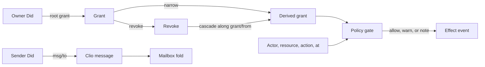

# Access model

Resource, grant, revoke, message, and mailbox are portable data. Katamorph
checks them and folds them. It does not perform I/O. A consumer supplies the
clock as an explicit instant and supplies every effect.

Clio already admits an event as `:event/id`, `:event/stream`, `:event/seq`, and
`:event/causes` (`clio.law.event` on open-hax/clio). The standard envelope
(`:event/type`, `:event/actor`, `:event/at`, `:event/body`, `:event/hash`) is
not a clio law yet. Messages carry those keys so a later clio envelope can
read them. Katamorph does not hash: `:event/hash` is an optional hex string
the consumer computed from clio's canonical form.

## Objects

- **Did.** A `did:` URI. Katamorph does not resolve it.
- **Resource.** `(kind, id, owner, store | location, metadata)`. `kind` is a
  keyword such as `:drive/folder` or `:msg/channel`. `id` is the stable
  identity. `owner` is a Did. `store` names a consumer store; `location` is a
  string or a portable map. At least one of store or location is present.
  Metadata is portable EDN.
- **Action.** A keyword, such as `:drive/put` or `:msg/send`.
- **Grant.** `(id, actor, resource, actions, policy, at, expires, from)`.
  `actor` is the Did that receives the allowance. `from` is absent on a root
  grant and is a parent grant id on a derived grant. `policy` is an optional
  gate id or an inline gate. `expires` is an optional instant.
- **Revoke.** `(id, actor, resource, actions, policy, at, expires)`. `at` is
  the instant the withdrawal takes effect. `actions` empty or absent withdraws
  every matched action. `expires`, when present, selects grants with that same
  expiry. It is not a time at which authority returns. `policy` records the
  gate that authorized the withdrawal; the fold does not consult it.
- **Message.** A clio event addressed to a Did: the clio identity keys, the
  envelope keys above, and `:msg/to`. `:msg/channel` is optional.
- **Channel.** A resource whose kind is `:msg/channel`. The `:channel`
  registration projects to that resource.
- **Mailbox.** The ordered fold of messages whose `:msg/to` is one Did.
  A `:mailbox` registration names that Did. It does not store the messages.
- **Policy gate.** The existing flat gate. A match is either a tool call
  (`:tool/name`, `:tool/params`) or a resource act (`:resource/kind`,
  `:resource/id`, `:action`). Outcomes stay `:block`, `:warn`, `:note`, and
  the default `:allow`.
- **Decision.** `{:action :block | :warn | :note | :allow}` at one instant.

## Morphisms

- `admit-resource : Value → Resource | error`
- `admit-grant : Grant × Grants → Grants | error` — defined only when the grant
  narrows its parent, or when it is a root grant.
- `revoke : Grants × Revoke → Grants` — deletes actions. It does not add them.
- `effective : Events × Instant → EffectiveGrants` — fold of grants and revokes.
- `decide : Events × Gates × Subject × Instant → Decision` — no clock read.
- `send : Did × Did × Body → Message`
- `mailbox : Did × [Message] → [Message]`
- `channel-resource : Channel → Resource`
- `export-edn` / `import-edn` — deterministic EDN. `canonical-form` (clio) is
  invariant under that round trip. It is a hash preimage, not the value encoding.

## Laws

1. **Revocation is monotone.** At a fixed instant, appending a revoke never
   increases the residual actions of any grant. For one grant that is already
   live, moving `at` forward never brings a withdrawn action back. `:revoke/expires`
   does not lapse. A new root grant is a new allowance; it is not an edit of a
   revoked grant.
2. **Revocation cascades.** Withdrawing actions from a grant withdraws those
   actions from every grant reachable through `:grant/from`. A child cannot
   keep an action its parent no longer has.
3. **Grants only narrow.** A derived grant is admitted only when its resource
   is the parent's resource, its actions are a subset of the parent's declared
   actions, and its expiry does not extend the parent's expiry. A parent with
   no expiry may be narrowed by any expiry. A parent with an expiry requires
   the child to name an equal or earlier expiry. Widening, extending, or naming
   a missing parent is rejected. The fold ignores an unlawful grant.
4. **Evaluation is a pure function of an explicit `at`.** `decide` and
   `effective` read no clock. A grant is live when `at` is at or after
   `:grant/at` (or `:grant/at` is absent) and strictly before `:grant/expires`
   (or `:grant/expires` is absent). A revoke applies when `at` is at or after
   `:revoke/at`. The same arguments yield the same decision.
5. **A mailbox is the fold of messages addressed to its Did.**
   `mailbox(did, xs ++ ys) = mailbox(did, xs) ++ mailbox(did, ys)`. Order is
   preserved. Messages addressed elsewhere are absent. Reading is this
   projection. Delivery is an append the consumer performs.
6. **One EDN, total on admitted values.** For every admitted resource, grant,
   revoke, message, mailbox, and channel, `import-edn(export-edn(x)) = x`.
   Export orders maps and sets by `pr-str`. `clio.shape.canonical/canonical-form`
   is unchanged by that round trip. Values clio will not canonicalize
   (functions, ratios, non-finite numbers, instants outside the portable
   Gregorian range) are refused at admission.

## Policy

A gate matches a subject when every entry in `:policy/match` matches.
`:tool/name` and `:tool/params` keep the behavior they have today, including
predicate values in params. `:resource/kind`, `:resource/id`, and `:action`
match by equality. A key the gate does not know matches nothing, so an old
tool-call gate does not start matching resource acts.

`decide` allows an action only when some live grant residual contains it for
that actor and resource, and the strongest matching gate is not `:block`.
No covering grant is `:block` with reason `:grant/absent`. No matching gate
is `:allow`, as before.
